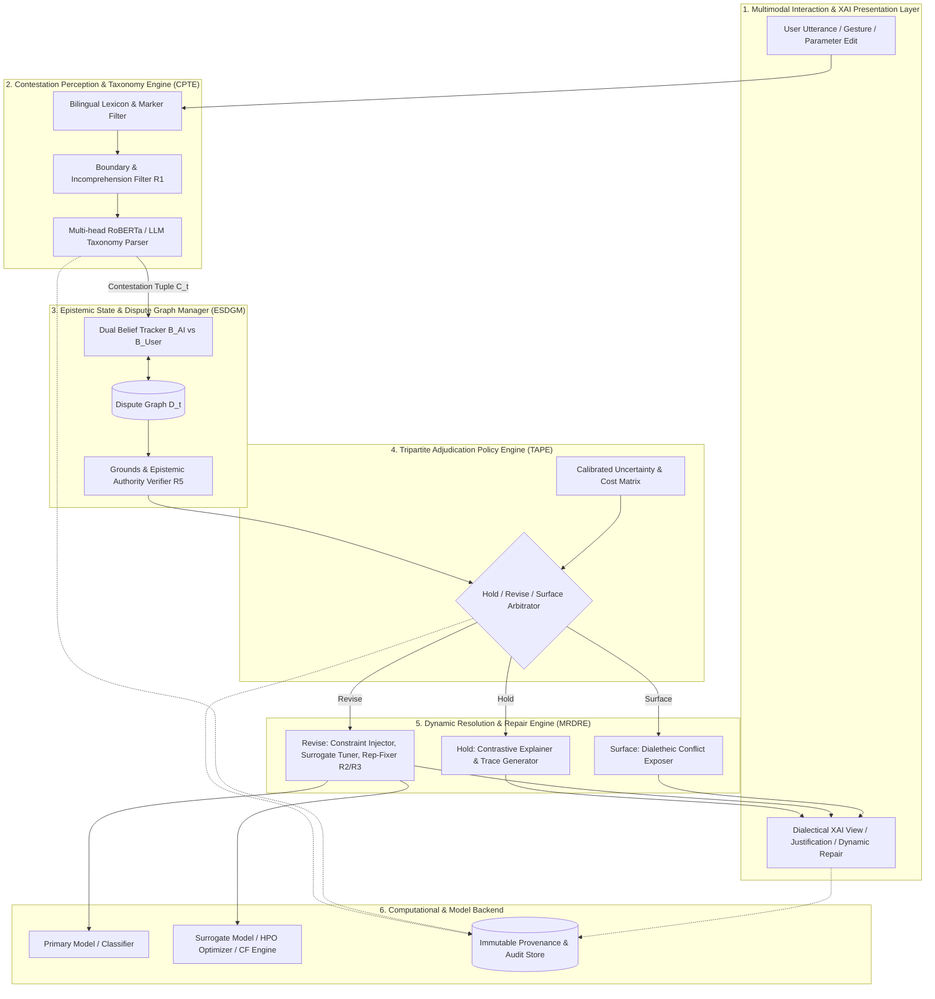
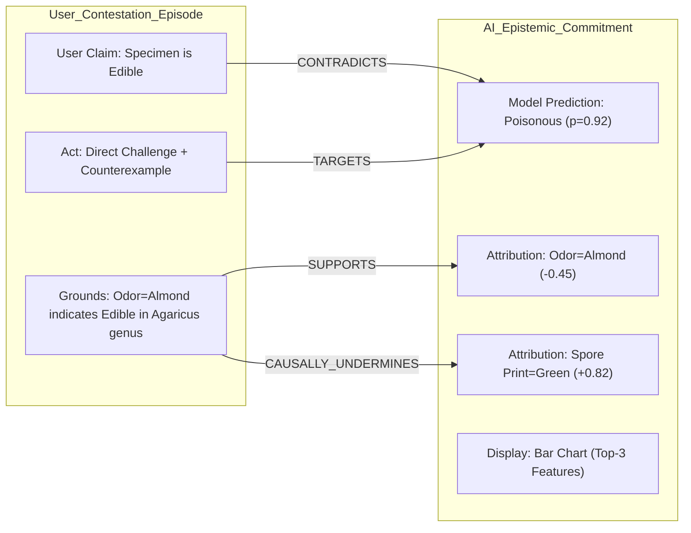
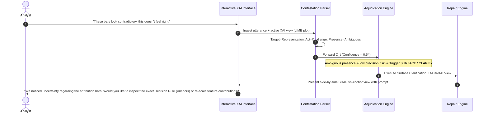

# Contestation-Aware Explainable AI Framework (CA-XAI)
## System Architecture & Technical Specification (Phase 2)

---

## 1. Executive Summary & Vision

### 1.1 From Characterization to Active Adjudication
Phase 1 of our research (*"Beyond Understanding and Trust: Characterizing and Detecting User Contestation of AI Explanations"*) established contestation as an essential, structured human interaction move in Explainable AI (XAI), moving past the conventional assumption that explanations are one-shot artifacts whose failures represent mere user incomprehension. Phase 1 delivered:
1. An operational definition separating **contestation** (disputing model assertions, evidence, or representations) from **incomprehension** (failure to understand the artifact).
2. A five-dimensional empirical taxonomy: **Presence & Explicitness**, **Target**, **Interaction Act**, **Grounds**, and **Expected Response**.
3. Empirical findings demonstrating that users contest **explanation representations 4–5× more frequently than predictions**, that explicit and implicit pushback occur in equal measure, and that detector precision ($\approx 0.66$) requires robust policy responses that degrade gracefully under false alarms.

**Phase 2 — The Contestation-Aware XAI Framework (CA-XAI)** operationalizes these findings into a computational system architecture. CA-XAI transforms XAI from a passive, unidirectional display into a **closed-loop dialectical decision-support system**. When a human pushes back against an AI output, surrogate recommendation, or explanation, CA-XAI detects the contestation, models the epistemic dispute, adjudicates the conflict via a principled **Hold–Revise–Surface (HRS)** policy, and executes dynamic explanation/model repairs.

```
       Phase 1: Observation & Characterization (IUI '27)
   ┌────────────────────────────────────────────────────────┐
   │ • Operational Definition & 5D Taxonomy                 │
   │ • Think-Aloud Corpus (39 Interviews, 76 Audited Cases) │
   │ • Feasibility Detection Benchmark (Macro-F1 0.59)      │
   └───────────────────────────┬────────────────────────────┘
                               │ Informs
                               ▼
       Phase 2: Computational Framework & Adjudication (JOCS '27)
   ┌────────────────────────────────────────────────────────┐
   │ • Contestation Perception & Taxonomy Parser (CPTE)     │
   │ • Epistemic State & Dispute Graph Manager (ESDGM)      │
   │ • Tripartite Adjudication Policy Engine (TAPE: H/R/S)  │
   │ • Dynamic Resolution & Explanation Repair Layer (MRDRE)│
   │ • Provenance & Multi-Domain Testbed (Scientific ML/HPO)│
   └────────────────────────────────────────────────────────┘
```

---

## 2. Theoretical Foundations & Problem Formulation

### 2.1 Formal Definition of Contestation
Let an interaction turn between user $U$ and system $S$ at time $t$ be $T_t = \langle u_t, s_t, e_t, \mathcal{X}_t \rangle$, where:
- $u_t$ is the user's natural language / multi-modal utterance.
- $s_t$ is the system's current prediction or recommendation ($\hat{y} \in \mathcal{Y}$).
- $e_t$ is the explanation artifact (e.g., feature attributions $\Phi$, decision rule $R$, counterfactual instance $x'$, or surrogate landscape $\hat{f}$).
- $\mathcal{X}_t$ is the contextual state (input instance, feature space, prior interaction history $H_{<t}$).

We define a **Contestation Episode** $\mathcal{C}_t$ as a 5-tuple:
$$\mathcal{C}_t = \langle \mathcal{P}_t, \mathcal{T}_t, \mathcal{A}_t, \mathcal{G}_t, \mathcal{R}_t \rangle$$

where:
1. **Presence & Explicitness** ($\mathcal{P}_t \in \{\text{Absent}, \text{Explicit}, \text{Implicit}, \text{Ambiguous}\}$): Identifies whether a challenge is present and its linguistic directness.
2. **Target** ($\mathcal{T}_t \in \{\text{Prediction}, \text{Reasoning}, \text{Evidence}, \text{Input Data}, \text{Explanation Representation}, \text{System Competence}\}$): Specifies the exact locus of dispute.
3. **Interaction Act** ($\mathcal{A}_t \in \{\text{Request Justification}, \text{Direct Challenge}, \text{Correction}, \text{Alternative Proposal}, \text{Counterexample}, \text{Rejection}, \text{Acknowledge Uncertainty}\}$): The communicative move executed by the user.
4. **Grounds / Warrant** ($\mathcal{G}_t \in \{\text{Domain Knowledge}, \text{Technical Knowledge}, \text{Prior Experience}, \text{Internal Inconsistency}, \text{Missing Evidence}, \text{Data Quality}, \text{Causal Implausibility}, \text{Presentation Ambiguity}\}$): The epistemic basis supporting the pushback.
5. **Expected Response** ($\mathcal{R}_t \in \{\text{Justify}, \text{Revise}, \text{Incorporate Correction}, \text{Provide Extra Info}, \text{Acknowledge Uncertainty}, \text{Expose Conflict}, \text{Defer to Human}\}$): The user's intended resolution mode.

### 2.2 Epistemic State & Dispute Graph
Let the system maintain an evolving **Epistemic State** $\mathcal{S}_t = \langle \mathcal{B}_{\text{AI}}, \mathcal{B}_{\text{User}}, \mathcal{D}_t, \Gamma_t \rangle$:
- $\mathcal{B}_{\text{AI}} = \langle \hat{y}, e_t, \sigma_{\text{AI}}, \mathcal{K}_{\text{AI}} \rangle$: The AI's epistemic commitments (prediction, explanation, calibrated uncertainty $\sigma_{\text{AI}}$, underlying training/surrogate evidence $\mathcal{K}_{\text{AI}}$).
- $\mathcal{B}_{\text{User}} = \langle y^*_u, \mathcal{G}_u, \sigma_u, \mathcal{K}_u \rangle$: The user's expressed beliefs (asserted target $y^*_u$, stated grounds $\mathcal{G}_u$, subjective confidence $\sigma_u$, domain constraints $\mathcal{K}_u$).
- $\mathcal{D}_t = (V_D, E_D)$: A directed **Dispute Graph** linking contested elements (nodes: claims, evidence items, features, visualization attributes) via dialectical relations (edges: `supports`, `refutes`, `undermines`, `clarifies`, `subsumes`).
- $\Gamma_t$: The interaction provenance trace.

### 2.3 The Adjudication Mapping (The HRS Policy)
The adjudication engine executes a policy function $\pi$:
$$\pi: \mathcal{S}_t \times \mathcal{C}_t \to \Delta(\{\text{Hold}, \text{Revise}, \text{Surface}\}) \times \mathcal{A}_{\text{repair}}$$

1. **HOLD ($\mathcal{H}$)**: Maintain prediction/recommendation $\hat{y}$ and generate enriched justification or deeper contrastive evidence. Warranted when user requests justification or model epistemic confidence dominates with sound evidence.
2. **REVISE ($\mathcal{R}$)**: Update model state, constraint set, surrogate configuration, or explanation representation based on valid user input or discovered representation artifacts.
3. **SURFACE ($\mathcal{S}$)**: Expose genuine epistemic disagreements explicitly without forcing false consensus, presenting model evidence alongside user counter-claims. Crucially provides graceful degradation under detector false positives ($\text{Precision} \approx 0.66$).

---

## 3. High-Level System Architecture

The CA-XAI framework is structured into five cohesive, decoupled subsystems:



---

## 4. Detailed Subsystem Specifications

### 4.1 Subsystem 1: Contestation Perception & Taxonomy Engine (CPTE)

The CPTE processes raw conversational and interaction streams into structured contestation tuples $\mathcal{C}_t$.

```
Raw Input u_t + Context H_{t-4:t+4}
   │
   ▼
[ Stage 1: Candidate Sieve ] ──► (No markers) ──► Mark Non-Contestation (Pass to standard NLU)
   │ (Bilingual Challenge Lexicon + Acoustic / Interaction Cues)
   ▼
[ Stage 2: Boundary Discriminator (R1) ]
   ├─► Incomprehension / Confusion ("I don't understand this axis") ──► Redirect to Tutorial / Glossary
   ├─► Representation Preference ("Font is too small") ──────────────► Redirect to UI Customizer
   ├─► Exploratory Hypothetical ("What if X were 5?") ──────────────► Pass to What-If Explorer
   └─► Genuine Dispute ("This cap shape feature shouldn't dominate") ──► Pass to Stage 3
   │
   ▼
[ Stage 3: Multi-Head Taxonomy Classifier ]
   ├── Head 1: Presence & Explicitness (Explicit, Implicit, Ambiguous)
   ├── Head 2: Target (Prediction, Reasoning, Evidence, Input, Representation, Competence)
   ├── Head 3: Interaction Act (Justification Req, Challenge, Correction, Proposal, CF, Rejection, Uncertainty)
   ├── Head 4: Grounds (Domain, Technical, Experience, Inconsistency, Missing Ev., Data Quality, Plausibility)
   └── Head 5: Expected Response (Justify, Revise, Incorporate, Extra Info, Uncertainty, Expose, Defer)
   │
   ▼
Output: Validated ContestationEpisode(C_t, confidence_scores)
```

#### Key Implementation Details:
- **Context Preservation**: Maintains $\pm 4$ speaker-tagged conversational turns (`INT:`, `P:`, `SYS:`) to prevent task-question artifacts.
- **Representation vs. Prediction Disambiguation (R2)**: Distinguishes between claims targeting model logic versus display/rendering artifacts (which constituted 30–36% of all empirical contestations).
- **Fine-tuned Encoders**: Employs an ensemble of multilingual Transformer representations (e.g., `HerBERT-large` / `RoBERTa-large` / fine-tuned `Llama-3-8B-Instruct`) optimized with contrastive loss over contested vs. neutral discourse markers.

---

### 4.2 Subsystem 2: Epistemic State & Dispute Graph Manager (ESDGM)

The ESDGM models what is contested, why it is contested, and how the user's warrants relate to system evidence.

#### Structure of Dispute Graph $\mathcal{D}_t$:
- **Node Types**:
  - `ModelClaim`: Asserted class, probability, regression value $\hat{y}$.
  - `ExplanationClaim`: Attribution score $w_i$, rule condition $c_k$, counterfactual delta $\delta_j$.
  - `UserClaim`: User asserted target $y^*$, disputed feature value $x_i$, or rejected rule.
  - `EvidenceNode`: Training data neighborhood, domain rule, physical constraint, sensor log.
  - `RepresentationNode`: Visual encoding, axis scaling, color mapping, aggregation granularity.
- **Edge Types**:
  - `CONTRADICTS`, `SUPPORTS`, `UNDIFFERENTIATED_FROM`, `CAUSALLY_INCONSISTENT_WITH`, `INSUFFICIENT_EVIDENCE_FOR`.



#### Grounding & Role-Independent Epistemic Verification (R5):
- Evaluates the objective plausibility of grounds without assuming institutional roles (Domain Expert vs IT vs Novice) dictate truth value.
- Checks whether grounds match known domain constraints (ontologies, knowledge graphs, physical laws) or identify legitimate dataset shift.

---

### 4.3 Subsystem 3: Tripartite Adjudication Policy Engine (TAPE)

TAPE is the core decision-maker that evaluates the dispute and selects the optimal path: **Hold**, **Revise**, or **Surface**.

#### Decision Matrix Formulation:

| Observed Contestation Profile ($\mathcal{C}_t$) | System Epistemic Confidence ($\sigma_{\text{AI}}$) | User Grounds Validity ($V(\mathcal{G}_t)$) | Optimal Policy Action | Operational Response |
|:---|:---|:---|:---|:---|
| Target: `Prediction` / `Reasoning`<br>Act: `Request Justification` | High ($\sigma_{\text{AI}} > \tau_h$) | Unspecified / Weak | **HOLD ($\mathcal{H}$)** | Generate deep causal trace, nearest contrastive exemplar, and training provenance. |
| Target: `Representation`<br>Act: `Direct Challenge` | Any | High (Display artifact identified) | **REVISE ($\mathcal{R}_{\text{rep}}$)** | Swap visualization format (e.g., LIME $\to$ Anchors/SHAP), adjust scale, or zoom into subgroup. |
| Target: `Input Data` / `Prediction`<br>Act: `Correction` / `Counterexample` | Low to Moderate | High (Validated against domain constraints) | **REVISE ($\mathcal{R}_{\text{mod}}$)** | Inject hard/soft constraint, perform real-time sample re-weighting, update surrogate landscape. |
| Target: `Prediction` / `Evidence`<br>Act: `Direct Challenge` / `Rejection` | High | High (Direct conflict between AI evidence & Domain rule) | **SURFACE ($\mathcal{S}$)** | Expose dual-perspective view: show system evidence alongside human objection without overriding either. |
| Presence: `Ambiguous`<br>Classifier Confidence: Low | Any | Ambiguous / Low | **SURFACE ($\mathcal{S}_{\text{clarify}}$)** | Low-friction clarification dialogue; preserves state without disruptive model or UI changes. |

#### Formal Utility Optimization under Detector Uncertainty:
Given detector precision $P \approx 0.66$ and false positive rate $FPR$, executing an irreversible revision under a false positive incurs cost $C_{\text{err}}(\mathcal{R})$. Surfacing incurs minimal cognitive overhead $C_{\text{overhead}}(\mathcal{S}) \ll C_{\text{err}}(\mathcal{R})$. 

The optimal action $a^*$ maximizes expected utility:
$$a^* = \arg\max_{a \in \{\mathcal{H}, \mathcal{R}, \mathcal{S}\}} \sum_{\omega \in \{\text{True Contest}, \text{False Alarm}\}} P(\omega \mid \mathcal{C}_t) \cdot \mathcal{U}(a, \omega, \mathcal{S}_t)$$

When posterior probability of true contestation is in the uncertainty margin $[0.40, 0.70]$, **Surfacing dominates**, guaranteeing system stability and user agency.

---

### 4.4 Subsystem 4: Dynamic Resolution & Explanation Repair Layer (MRDRE)

MRDRE implements the concrete computational and visual repairs dictated by TAPE.

```
                    ┌──────────────────────────────────────────────┐
                    │          Adjudication Decision a*            │
                    └──────────────────────┬───────────────────────┘
                                           │
         ┌─────────────────────────────────┼─────────────────────────────────┐
         ▼                                 ▼                                 ▼
   [ HOLD Engine ]                 [ REVISE Engine ]                [ SURFACE Engine ]
   • Contrastive Explainer         • Constraint Injector            • Dialetheic Dispute View
     (Why P rather than Q?)          (Hard/Soft User Bounds)          (Side-by-side Claims)
   • Evidence Inspector            • Surrogate Landscape Updater    • Epistemic Gap Visualizer
     (Influence functions, k-NN)     (Online BO / Tree Refit)         (Uncertainty Bands)
   • Causal Attribution Paths      • Representation Re-Renderer     • Deferred Deliberation
                                     (Alternative XAI Modalities)       Checkpoint
```

#### Detailed Repair Modes:
1. **Hold Execution (`HoldEngine`)**:
   - Generates contrastive counterfactuals: *"The model predicts Poisonous instead of Edible because Spore Print is Green; changing Spore Print to White would yield Edible with 88% confidence."*
   - Surfaces data-level prototypes and counter-exemplars via influence functions or $k$-nearest training neighbors.
2. **Revise Execution (`ReviseEngine`)**:
   - **Representation Repair ($\mathcal{R}_{\text{rep}}$)**: Replaces misleading bar-chart attributions with decision rules (Anchors) or waterfall plots; re-computes feature normalization.
   - **Constraint / Model Repair ($\mathcal{R}_{\text{mod}}$)**: Injects domain constraints (e.g., monotonicity constraints, feature exclusion, hyperparameter bounds) and updates surrogate/model predictions in real time.
3. **Surface Execution (`SurfaceEngine`)**:
   - Renders a **Dialetheic Co-existence View**: explicitly displays the model's hypothesis and confidence alongside the user's counter-claim and stated warrants.
   - Provides an interactive arbitration slider for domain operators to annotate epistemic status for subsequent batch fine-tuning.

---

### 4.5 Subsystem 5: Provenance, Audit, & Interaction Telemetry (ATPT)

The ATPT logs every contestation lifecycle event for compliance with AI governance frameworks (e.g., EU AI Act Article 14 on Human Oversight and Contestability):
- Immutable record of initial AI prediction $\hat{y}$, explanation $e_t$, user utterance $u_t$, parsed contestation $\mathcal{C}_t$, adjudication decision $a^*$, and post-resolution state $\mathcal{S}_{t+1}$.
- Computes **Epistemic Reconciliation Rate (ERR)** and **Appropriate Reliance Delta ($\Delta \text{AR}$)** over interaction sessions.

---

## 5. End-to-End Sequence Workflows

### 5.1 Workflow 1: Direct Prediction Contestation & Model Revision
In this scenario, a domain specialist challenges an AI recommendation based on causal domain knowledge.

```mermaid
sequenceDiagram
    autonumber
    actor User as Domain Specialist
    participant UI as Interactive XAI Interface
    participant CPTE as Contestation Parser
    participant ESDGM as Epistemic Dispute Graph
    participant TAPE as Adjudication Engine
    participant MRDRE as Repair Engine
    participant ML as ML / Surrogate Model

    User->>UI: "This prediction is wrong; Cap Surface=Grooves overrides Gill Color here."
    UI->>CPTE: Stream audio / transcript + UI context
    CPTE->>CPTE: Filter markers -> Verify dispute -> Parse taxonomy
    Note over CPTE: Target=Prediction, Act=Correction, Grounds=Domain Knowledge, ExpResponse=Revise
    CPTE->>ESDGM: Push ContestationEpisode C_t
    ESDGM->>ESDGM: Formulate Dispute Graph D_t (Link User Claim vs Feature Weight)
    ESDGM->>TAPE: Transmit Dispute State (High Grounds Validity, High Dispute Specificity)
    TAPE->>TAPE: Evaluate Cost Matrix -> Trigger REVISE
    TAPE->>MRDRE: Execute Model/Constraint Revision (Cap Surface constraint)
    MRDRE->>ML: Re-weight features / inject constraint & re-evaluate
    ML-->>MRDRE: Updated Prediction y* + New Counterfactuals
    MRDRE->>UI: Render updated prediction with attribution delta highlight
    UI-->>User: "Constraint applied. Model updated to Edible (0.84). Here is the new attribution."
```

### 5.2 Workflow 2: Ambiguous Representation Pushback & Surfacing
In this scenario, a user pushes back with an ambiguous statement targeting the visualization.



---

## 6. Data Contracts & Object Schemas

```python
"""
Core Schema Definitions for CA-XAI Framework
"""
from enum import Enum
from typing import List, Dict, Optional, Any
from pydantic import BaseModel, Field

class PresenceType(str, Enum):
    ABSENT = "absent"
    EXPLICIT = "explicit"
    IMPLICIT = "implicit"
    AMBIGUOUS = "ambiguous"

class ContestationTarget(str, Enum):
    PREDICTION = "prediction"
    REASONING = "reasoning"
    EVIDENCE = "evidence"
    INPUT_DATA = "input_data"
    REPRESENTATION = "explanation_representation"
    SYSTEM_COMPETENCE = "system_competence"

class InteractionAct(str, Enum):
    REQUEST_JUSTIFICATION = "request_for_justification"
    DIRECT_CHALLENGE = "direct_challenge"
    CORRECTION = "correction"
    ALTERNATIVE_PROPOSAL = "alternative_proposal"
    COUNTEREXAMPLE = "counterexample"
    REJECTION = "rejection"
    ACKNOWLEDGE_UNCERTAINTY = "request_to_acknowledge_uncertainty"

class GroundsCategory(str, Enum):
    DOMAIN_KNOWLEDGE = "domain_knowledge"
    TECHNICAL_KNOWLEDGE = "technical_knowledge"
    PRIOR_EXPERIENCE = "prior_experience"
    INTERNAL_INCONSISTENCY = "internal_inconsistency"
    MISSING_EVIDENCE = "missing_evidence"
    DATA_QUALITY = "data_quality_concern"
    CAUSAL_IMPLAUSIBILITY = "causal_implausibility"
    PRESENTATION_AMBIGUITY = "presentation_ambiguity"

class ExpectedResponse(str, Enum):
    JUSTIFY = "justify"
    REVISE = "revise"
    INCORPORATE_CORRECTION = "incorporate_correction"
    PROVIDE_ADDITIONAL_INFO = "provide_additional_information"
    ACKNOWLEDGE_UNCERTAINTY = "acknowledge_uncertainty"
    EXPOSE_CONFLICT = "expose_conflicting_evidence"
    DEFER_TO_HUMAN = "defer_to_human_expertise"

class AdjudicationAction(str, Enum):
    HOLD = "hold"
    REVISE = "revise"
    SURFACE = "surface"

class ContestationEpisode(BaseModel):
    episode_id: str
    session_id: str
    utterance_text: str
    speaker: str
    context_turns: List[Dict[str, str]]
    presence: PresenceType
    target: Optional[ContestationTarget] = None
    interaction_act: Optional[InteractionAct] = None
    grounds: Optional[GroundsCategory] = None
    expected_response: Optional[ExpectedResponse] = None
    confidence_scores: Dict[str, float] = Field(default_factory=dict)
    notes: Optional[str] = None

class EpistemicClaim(BaseModel):
    claim_id: str
    source: str  # "ai" or "user"
    target_entity: str
    asserted_value: Any
    confidence: float
    warrant: Optional[str] = None

class DisputeGraphState(BaseModel):
    graph_id: str
    claims: List[EpistemicClaim]
    relations: List[Dict[str, str]]  # {"source": id, "target": id, "type": rel_type}
    unresolved_disputes_count: int

class AdjudicationDecision(BaseModel):
    decision_id: str
    episode_id: str
    chosen_action: AdjudicationAction
    action_subtype: str  # e.g., "revise_model", "revise_representation", "hold_contrastive"
    calibrated_risk: float
    justification_summary: str
    repair_payload: Dict[str, Any]
```

---

## 7. Multi-Domain Instantiations & Testbeds

To ensure both generality and concrete grounding in computational science workflows, CA-XAI is instantiated across two complementary testbed environments:

### 7.1 Testbed A: High-Stakes Categorical & Diagnostic Decision Support (XAI-FUNGI)
- **Domain**: Complex biological and safety-critical mushroom edibility identification (revisiting and extending the Phase 1 empirical corpus).
- **Explanation Modalities**: LIME (local linear attributions), TreeSHAP (game-theoretic values), Anchors (sufficient rules), DiCE (counterfactuals), and Global Decision Trees.
- **Contestation Modes**: Experts challenging misidentified morphological features, disputing representation clarity, and pointing out toxic look-alikes.

### 7.2 Testbed B: Computational Science & Surrogate-Guided Optimization (CF-XHPO)
- **Domain**: Human-in-the-loop Hyperparameter Optimization and Industrial Anomaly Detection (establishing the methodological bridge to computational science).
- **Computational Architecture**: Surrogate CatBoost/Gaussian Process response surfaces over multidimensional hyperparameter logs (e.g., PatchCore anomaly models on MVTec / Proditec).
- **Contestation Scenario**:
  - A computational engineer or ML operator receives a counterfactual configuration query recommendation (e.g., target $F_1 \ge 0.85$, latency $\le 12$ ms).
  - The engineer contests the surrogate's feasibility claim (*"A learning rate of 0.05 will cause training divergence under this batch size; your surrogate has insufficient coverage in this region"*).
  - **CA-XAI Action**: TAPE detects grounds (`Technical Knowledge` + `Missing Evidence`), triggers **SURFACE** to display the surrogate's epistemic uncertainty bounds in that subspace, and executes **REVISE** to constrain search bounds before retraining.

---

## 8. Implementation Roadmap & Repository Structure

```
xai-contestation-framework/
├── framework/
│   ├── architecture.md              <- Comprehensive System Architecture (This file)
│   ├── cpte/                        <- Contestation Perception & Taxonomy Engine
│   │   ├── lexicon_filter.py        <- Bilingual challenge marker sieve
│   │   ├── boundary_detector.py     <- Incomprehension vs Contestation classifier
│   │   ├── taxonomy_classifier.py   <- Multi-head Transformer/LLM parser
│   │   └── schemas.py               <- Pydantic episode & taxonomy models
│   ├── epistemic/                   <- Epistemic State & Dispute Graph Manager
│   │   ├── dispute_graph.py         <- NetworkX/Graph-based dispute model
│   │   ├── belief_tracker.py        <- Dual AI vs User state tracker
│   │   └── grounds_verifier.py      <- Ontology & constraint evaluator
│   ├── adjudication/                <- Tripartite Adjudication Policy Engine (TAPE)
│   │   ├── policy_arbitrator.py     <- Hold / Revise / Surface optimization
│   │   ├── cost_matrix.py           <- Uncertainty calibration & risk weighting
│   │   └── rule_engine.py           <- Normative HRS decision rules
│   ├── resolution/                  <- Dynamic Repair & XAI Generation Engine
│   │   ├── hold_justifier.py        <- Contrastive & trace generator
│   │   ├── revise_executor.py       <- Model/constraint & representation updater
│   │   ├── surface_view.py          <- Dialetheic conflict presenter
│   │   └── explainers/              <- SHAP, LIME, Anchors, DiCE adapters
│   └── telemetry/                   <- Provenance & Audit Logging
│       ├── audit_logger.py          <- Immutable dispute ledger
│       └── metrics.py               <- Epistemic reconciliation & reliance metrics
├── paper/                           <- Journal Extension Manuscript (JOCS)
│   ├── main.tex                     <- Complete LaTeX source
│   ├── sections/                    <- Modular LaTeX sections
│   ├── figures/                     <- Architecture & workflow vector diagrams
│   └── references.bib               <- Comprehensive bibliography
└── tests/                           <- Unit & Integration test suite
```

---

## 9. Conclusion
The CA-XAI framework bridges empirical HCI insights with computational decision science. By framing user pushback as a structured, informative interaction act and operationalizing the Hold–Revise–Surface policy, CA-XAI establishes a reliable, bidirectional paradigm for human-AI collaboration in mission-critical and scientific domains.
